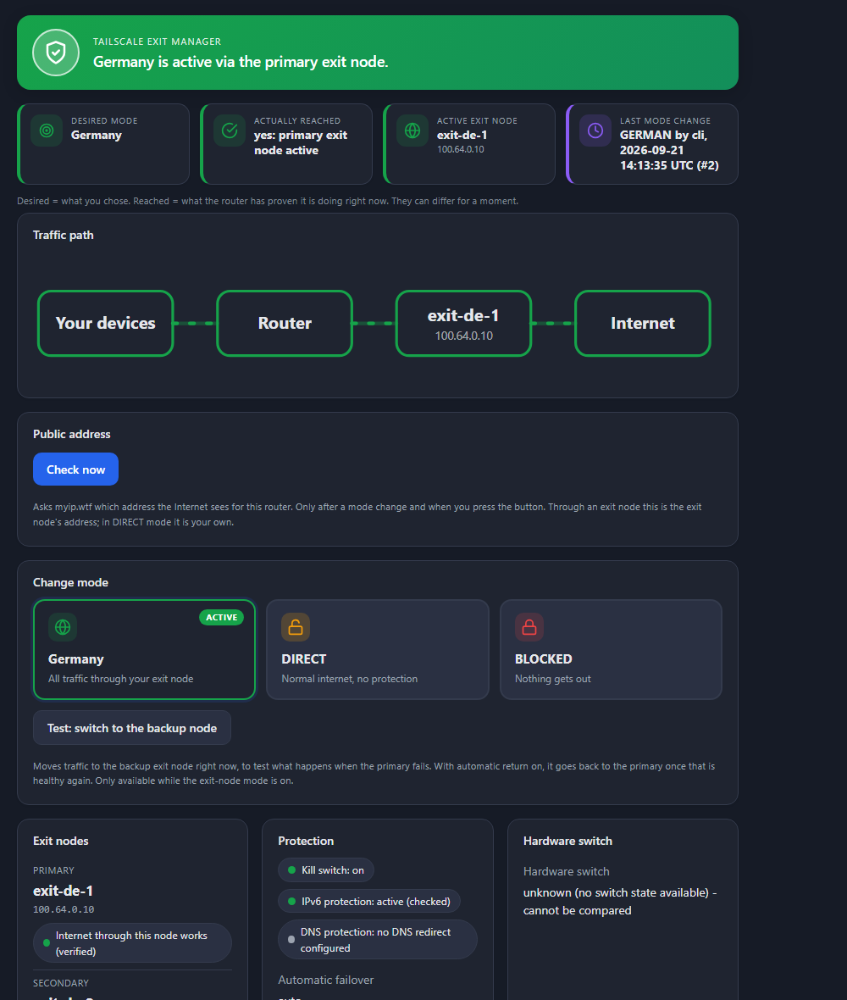
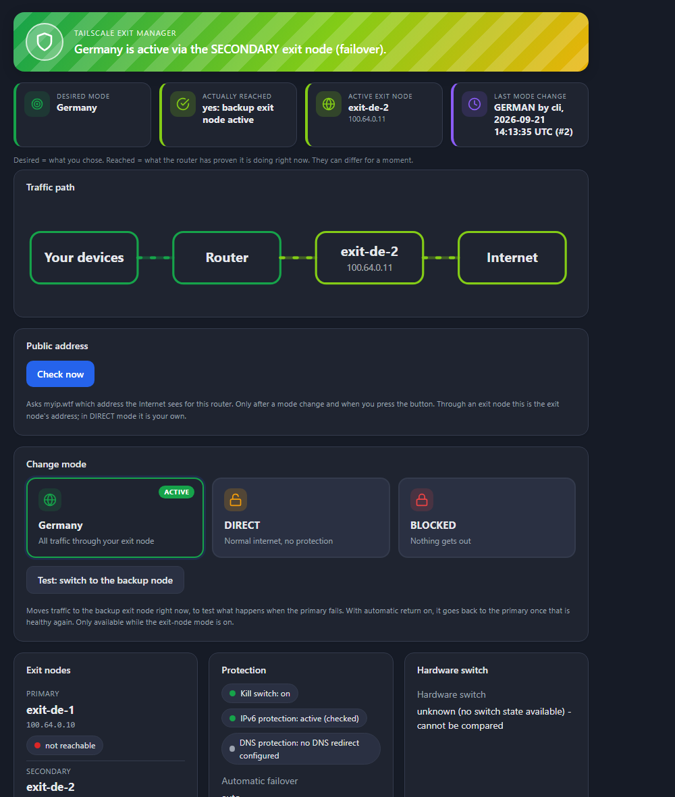
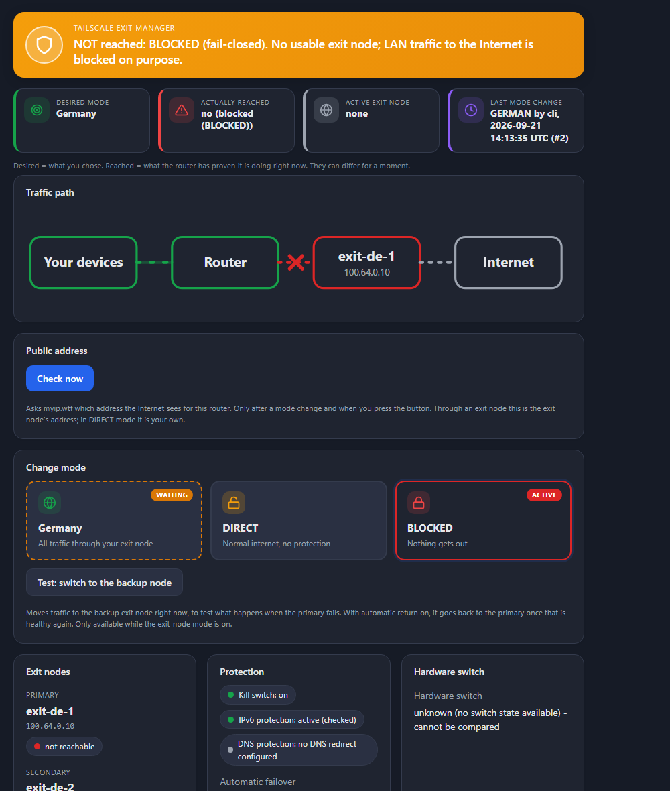
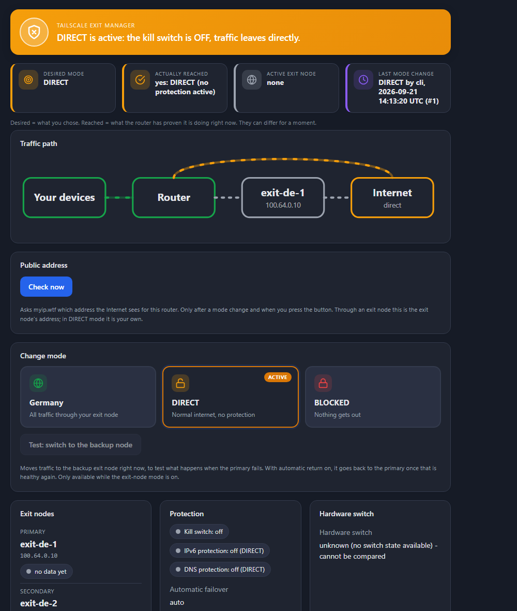

<h1 align="center">TSEM: Tailscale Exit Manager</h1>
<p align="center"><b>Fail-closed exit-node manager for GL.iNet / OpenWrt routers.</b><br>Your router. Your exit node. Never the wrong way out.</p>

<p align="center">
  <a href="LICENSE"></a>
  <a href="https://github.com/mompl/glinet-tailscale-exit-manager/actions"></a>
  
  
</p>

<p align="center"><a href="https://mompl.github.io/glinet-tailscale-exit-manager/">Project page</a> · <a href="#install-one-step">Install</a> · <a href="docs/final-report.md">What is tested</a> · <a href="#donations">Support</a></p>

<p align="center">
  
</p>

Fail-closed exit-node manager. Your LAN either goes out through a Tailscale exit node you chose, or directly, or nowhere: it never
silently falls back to your own internet connection.

<table>
  <tr>
    <td align="center"><b>Backup node took over</b><br></td>
    <td align="center"><b>BLOCKED: nothing leaks</b><br></td>
    <td align="center"><b>DIRECT</b><br></td>
  </tr>
</table>

<sub>These are the real interface file of TSEM (as shown under APPLICATIONS in the GL.iNet web UI), rendered with recorded replies of the real
controller on its mock backend, with neutral node names and documentation addresses. They are not photos of a live router. You can try it
on the <a href="https://mompl.github.io/glinet-tailscale-exit-manager/">project page</a>. Regenerate them with <code>tools/record-gui-fixtures.js</code>.</sub>

| Mode | What happens |
|---|---|
| **DIRECT** | Normal internet through your WAN. Nothing is rerouted. |
| **EXIT** (the protected mode; give it any name you like, e.g. "Germany" or "Office VPN": `--mode-label`, `TSEM_MODE_LABEL`) | All LAN traffic and the router's own traffic leave through the primary exit node. If it fails, the secondary takes over; if both fail, the router goes to BLOCKED. When the primary is healthy again it returns automatically. |
| **BLOCKED** | Fail-closed state: no internet for the LAN and no internet for the router itself (no WAN leak). Used automatically when no exit node is usable. |

Controls: GL.iNet web UI (**APPLICATIONS > Tailscale Exit Manager**), LuCI, the command line (`tsem`), Home Assistant, and the
physical toggle switch if your router has one (optional).

> **Status (1.2).** Version 1.1 added an ordered list of up to 8 exit nodes, push messages without Home Assistant (ntfy/webhook), configuration backup/restore and access to the router over a WAN-side admin network. Version 1.2 adds the choice of your own or the public ntfy server with access tokens, temporary DIRECT (`tsem set direct --for 1h`), a leak test, and statistics with an optional weekly message (see `CHANGELOG.md`).

> **Hardware status.** Tested in network namespaces with real kernel netfilter and on real routers: **GL.iNet GL-MT3000** (firmware 4.11.x) and **GL.iNet GL-MG1300** (firmware 4.11.1) fully; **GL-E5800 (Mudi 7)** installed and checked with a simulated client (experimental, no real Wi-Fi client yet). Other GL.iNet/OpenWrt routers may work (the installer checks the device first and
> refuses what it does not recognise) but are untested. See `docs/final-report.md` for exactly what has and has not been tested.

> **Disclaimer: no warranty, use at your own risk.** TSEM changes the firewall and routing rules of your router. It is built to
> fail closed, but **no software can guarantee that no traffic ever leaks** (firmware differences, hardware offloading, bugs). Test
> it yourself with your router, firmware and clients, and keep a way to reach the router that does not depend on it (LAN cable,
> `ssh` over the LAN). It is not a replacement for advice from a security professional where your safety depends on it. The software
> is provided "as is" under the Apache License 2.0, without warranty of any kind, and the author is not liable for any damage, loss
> or consequence of its use (see `LICENSE`, sections 7 and 8). *Deutsch: Keine Gewährleistung und keine Haftung, Nutzung auf eigene
> Gefahr. Teste selbst und halte immer einen Zugang zum Router bereit, der nicht von TSEM abhängt.*

## Install (one step)

Requirements: a GL.iNet or OpenWrt router with **iptables**, **Tailscale installed, logged in and running**, and at least one
Tailscale **exit node** that is approved in your tailnet.

```sh
# on your computer: copy the release archive to the router, unpack it there, run the setup
scp tsem-<version>.tar.gz root@192.168.8.1:/tmp/
ssh root@192.168.8.1
cd /tmp && tar xzf tsem-<version>.tar.gz && cd tsem-<version>
sh setup.sh
```

`setup.sh` shows six steps with OK / WARN / FAIL, asks only for your exit nodes (and optionally the subnets behind them), and
ends with **SUCCESS**, **SUCCESS WITH WARNINGS** or **FAILED** plus a report file (`/etc/tsem/last-setup-report.txt`) you can attach to
an issue.

1. checks the router (tools, Tailscale, GL.iNet UI, hardware switch, free space)
2. installs everything in one transaction (any failure restores the previous state)
3. lets you pick the primary and secondary exit node from your tailnet
4. runs the self test
5. starts the service in **DIRECT** mode and proves the router still has internet; if not, it puts everything back
6. optional: switches to the protected mode (`--exit`)

It never switches to the protected mode by itself unless you pass `--exit`, and then it returns to DIRECT automatically if the
exit node does not come up.

Non-interactive: `sh setup.sh --yes --primary my-exit-node --secondary my-backup-node [--fallback third-node ...] [--exit] [--mode-label "Germany"]`
Options: `sh setup.sh --help`. Without a GL.iNet web UI the LuCI view is installed; without a hardware switch no switch hook is
installed (modes are set in the GUI, with `tsem set exit|direct`, or from Home Assistant).

The setup adapts to the router it runs on:
- **Missing IPv6 firewall tool:** if IPv6 is enabled in the kernel but `ip6tables` is missing, the package that matches the
  router's iptables flavour (`ip6tables-nft` or `ip6tables-zz-legacy`) is installed with `opkg`. This needs Internet on the router;
  `--no-deps` turns it off (the setup then stops and tells you which package to install).
- **Hardware toggle button:** if the router has one and its function is not set yet, the setup sets it to the tsem hook
  (`switch-button func=tailscale-de`; uninstall removes it again). A function you chose yourself (for example VPN) is never changed.
- **Old prototype rule `ts_block_lan_leak`** (blackholes the LAN at boot): it is only reported; `--remove-legacy-rule` removes it, or
  you are asked in an interactive run. A backup is written to `/root/network.before-ts_block_lan_leak`.
- **Exit node names** come from Tailscale (give a name or a 100.x address, the other one is looked up).
- **An exit node the router already uses** (set in GL.iNet's own Tailscale page): tsem starts in DIRECT and would clear it, so the traffic
  would suddenly leave directly. The setup never decides that silently: without a choice it stops before changing anything.
  `--adopt-exit-node` takes the node over as the primary and goes straight to the exit-node mode (never through DIRECT); the GL.iNet
  page stops setting its own exit node (it re-applies it on every network event and would fight the failover), and `uninstall.sh`
  gives it back. If the exit-node mode does not come up, the previous exit node is set again and tsem is stopped.
  `--ignore-existing-exit-node` installs anyway and accepts the direct traffic.
- **GL-E5800 (Mudi 7):** this model has no hardware toggle switch, so it gets no switch hook. All other models are unchanged.

## Use

```sh
tsem status           # mode, state, exit node
tsem set exit         # protected mode (exit node + kill switch)
tsem set direct       # normal internet
tsem set direct --for 1h   # normal internet for an hour, then back to where it came from (30m, 2h, 90 = minutes; 1 minute to 24 hours)
tsem nodes            # exit nodes of your tailnet
tsem selftest         # checks the installation
tsem backup | restore # save / restore the settings (no secrets)
tsem-notify test      # send a test message (ntfy or webhook, see docs/rc/notifications.md)
```

## Remove

```sh
sh uninstall.sh --yes             # removes everything this package installed (backups restored)
sh install.sh --rollback --yes    # undo only the last installation
```

## More

`CHANGELOG.md`, `docs/rc/notifications.md` (messages to phones, own ntfy server), `docs/firmware-upgrade.md`, `docs/final-report.md` (what is tested, what is not), `docs/native-gui.md`, `docs/rc/operations.md`, `docs/rc/dns-ipv6.md`,
`docs/rc/router-egress.md` (what the kill switch allows and why), `homeassistant/` (integration), `docs/emergency-recovery.md`.
Run the tests: `sh tests/run.sh` (Linux with iptables; the packet tests need root and network namespaces).

## Donations

TSEM is free software. If it is useful to you, you can support its development voluntarily:

**Bitcoin:** `bc1quh4ucr0atp8h8q9xrzxvysypz0py3m8vpp0rny`

A donation is a voluntary gift. It creates no claim to support, features, updates or warranty. Please check the address against
this repository's `README.md` on GitHub before you send anything.

## Contributing and security

Contributions are welcome: see `CONTRIBUTING.md`. Please report security problems privately as described in `SECURITY.md`.

## License

Copyright 2026 mompl. Licensed under the Apache License, Version 2.0: see `LICENSE` and `NOTICE`.
